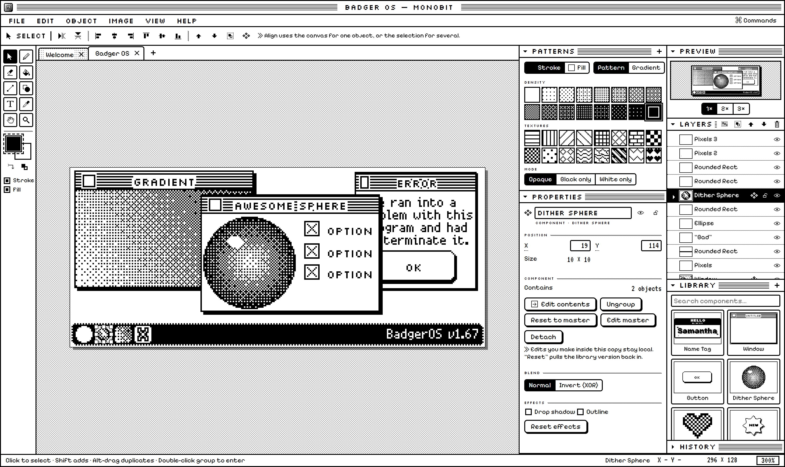
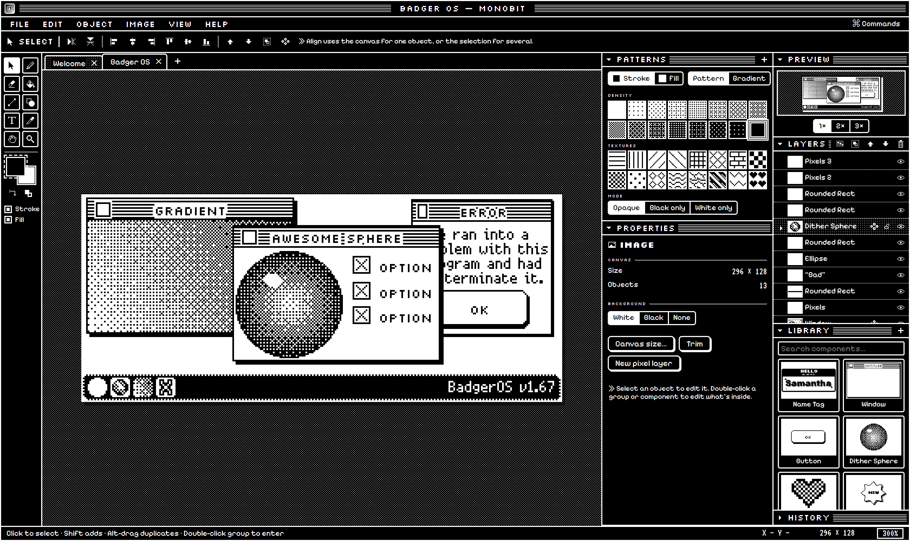

# Monobit — 1-bit pixel art studio

A black-and-white pixel art editor built with **Tauri 2 + Rust** (backend) and **TypeScript + Vite** (frontend).
Every pixel is either black or white; greys are made with dither patterns.





The mockup in these screenshots is included as [docs/examples/badger-os.monobit](docs/examples/badger-os.monobit) — open it from File → Open.

## Features

**Canvas & documents**
- Any canvas size up to 4096×4096, with presets (icons, sprites, OLED/e‑ink display sizes, VGA…)
- White, black or transparent background; canvas resize with 9-point anchor; crop to selection; trim
- Multiple documents in tabs; session is restored automatically on next launch
- Unlimited-feel undo/redo (200 steps) with a clickable History panel

**Paint = patterns, not colours**
- 16 ordered-dither density patterns (white → black, Bayer 4×4)
- 16 texture patterns (bricks, weave, scales, hearts…) + your own 8×8 custom patterns (pattern editor)
- Dithered linear/radial gradients (ordered or noise)
- Paint modes: *Opaque*, *Black only* (white bits transparent), *White only*
- Separate Stroke and Fill slots (X swaps, D resets); number keys 1–0 pick densities
- Pattern picker tool: grab any object's paint, or any 8×8 tile of the canvas as a new pattern

**Tools**
- **Pencil / Eraser**: 1–32 px square or round brush, pixel-perfect 1px lines, horizontal/vertical mirror drawing, Shift-click straight lines, right-click paints with the fill pattern
- **Fill bucket**: contiguous or global, sample all layers or current layer; click a shape/text to set its fill non-destructively
- **Line**: solid, dashed or dotted; any width; arrowheads; polyline mode (click points, Enter to finish, click the start to close)
- **Shapes**: rectangle, rounded rectangle, ellipse, triangle, right triangle, diamond, polygon, star, heart, arrow — all with solid/dashed/dotted borders of any width and any fill (or none); rotation, flips
- **Text**: 6 true pixel-grid fonts (exact at their native size), 8 pixel-styled fonts, plus system fonts, all binarised cleanly via 8× supersampling; bold, italic, underline, letter/line spacing, alignment, threshold
- **Image import** (and paste from clipboard): Atkinson, Floyd–Steinberg, Stucki, ordered 4×4/8×8, halftone, noise or threshold dithering — stays editable (brightness, contrast, gamma, invert, transparent white, resize re-dithers)

**Objects, layers & effects**
- Everything is an editable object: move, resize (handles), nudge, align, distribute, flip, lock, hide, rename
- Drop shadow (offset, *drop* or *extrude* style, any pattern) and outline (width, square/round) on any object or group
- Invert (XOR) blend mode
- Layers panel with thumbnails, drag-to-reorder (including into groups), nested group tree
- Group/ungroup, double-click to edit inside a group, rasterize, merge down, flatten

**Components**
- Save any selection as a reusable component (Ctrl+K); the Library comes pre-seeded (name tag, window, button, badge, sphere…)
- Insert by double-click or drag & drop onto the canvas
- Placed copies stay fully editable per object (enter the copy, edit/reorder its parts); *Reset to master* pulls the library version back in
- *Edit master* opens the component in its own tab; saving updates the library and offers to update every placed copy
- Import/export the library as a file

**Export**
- PNG (true 1-bit, or 2-bit indexed when transparent), monochrome BMP, PBM, at 1×–16× scale
- C header (Arduino / Adafruit GFX / u8g2 byte array) and XBM
- Copy image to the clipboard
- Encoders live in Rust (`src-tauri/src/lib.rs`, with unit tests)

**Interface**
- Pure two-colour retro UI with pixel fonts, striped title bars, dithered shadows and stepped animations (zooming-rectangle dialogs, dithered splash dissolve, marching ants)
- Inverted (dark) theme, pixel-perfect UI scaling for 125%/150% displays, command palette (Ctrl+Shift+P), full keyboard shortcuts (F1)

## Development

Requirements: Node 18+, Rust (stable, MSVC toolchain on Windows), and on Windows the Visual Studio C++ build tools + Windows SDK.

```powershell
npm install
npm run tauri dev       # run the desktop app with hot reload
npm run tauri build     # build the release app + installers
npm run dev             # UI only, in a browser at http://localhost:1420 (no file system / native export)
```

Rust tests: `cd src-tauri; cargo test`.

## Project layout

```
src/core      document model, raster primitives, renderer, patterns, fonts, dithering, serialization
src/editor    viewport (zoom/pan/overlays) and tools
src/app       state, history, actions, commands/shortcuts, Tauri bridge
src/ui        shell (title/menu/options/toolbox/tabs/status), panels, dialogs, overlays
src-tauri     Rust backend: file I/O, app storage, PNG/BMP/PBM/C/XBM encoders, clipboard
```

Documents are saved as `.monobit` (JSON with run-length-encoded pixel data).
App data (settings, library, session) lives in the OS app-data folder under `com.monobit.studio`.
